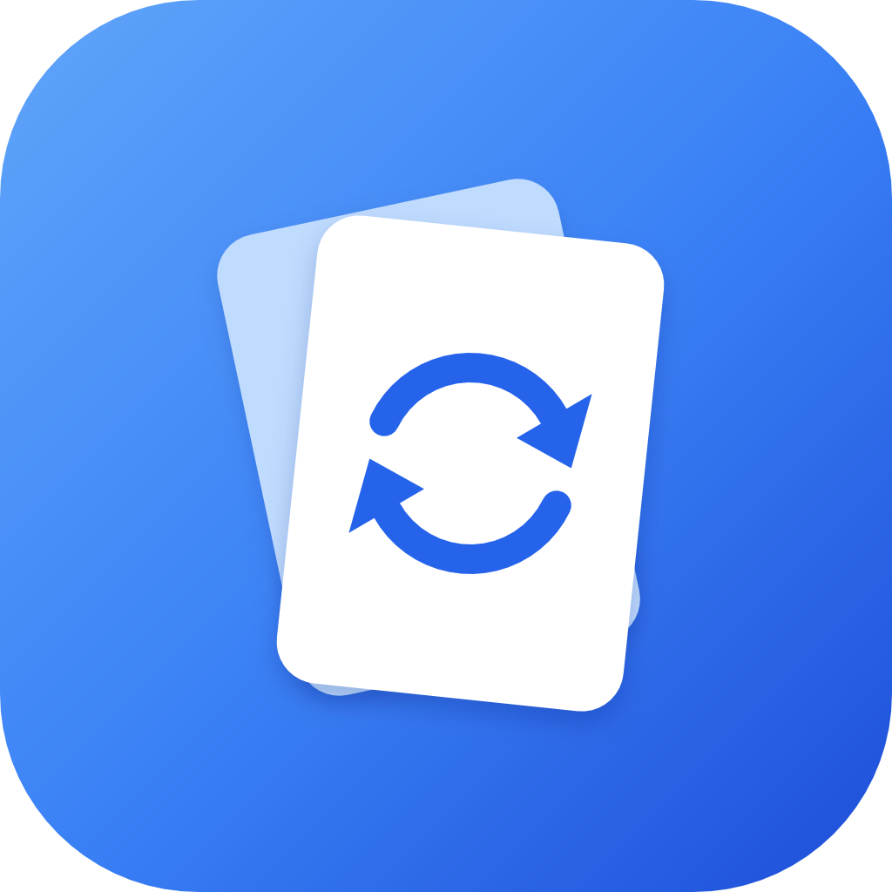
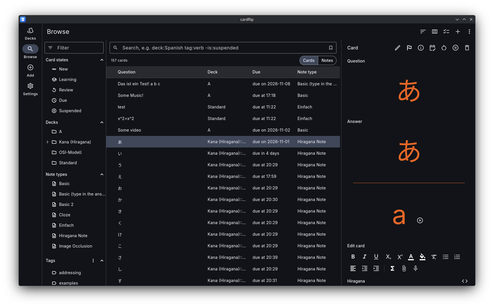

<p align="center">
  
</p>

<h1 align="center">Cardflip</h1>

<p align="center">
  
</p>

Cardflip is a spaced-repetition flash card trainer, similar to Anki, for
Linux, Windows, macOS, Android, iOS and the web.

- **Learns with you.** Reviews are scheduled with FSRS, a modern
  spaced-repetition algorithm.
- **Keeps you going.** A quiet streak counts the days in a row you studied,
  allowing up to two rest days a week if you like, and an optional daily
  goal of cards or minutes shows how far you are today, with a short
  celebration when you reach it. Achievements mark milestones in bronze,
  silver, gold and platinum: answers, your longest streak, study days, hours
  spent studying, days you met your goal, cards in long-term memory, the
  level you reached, and coming back after a break. Every session also earns
  experience points (XP): 1 per answer, 10 per study day, 20 per day you met
  your goal, 5 per card reaching long-term memory, and 25 to 200 per
  achievement tier. They add up to a level, which needs 50 more XP for each
  step (level 10 at 2,250 XP) and has no top. At the start of each week, a recap compares last week's study
  days, answers, study time and retention with the week before. All of it
  comes from your review history, so imports and other devices count too,
  with their real dates, and you can turn it off. Each deck also shows how
  far along it is: a bar of its new, learning, young and mature cards and
  the share already mature, optionally right in the deck list.
- **Brings your cards along.** Import CSV/TSV text files, Anki decks
  (`.apkg`) and Anki collections (`.colpkg`), including their templates,
  styling, images, audio and video.
- **Keeps your data yours.** There is no account and no server. Everything
  stays on your device, your own devices sync directly with each other on
  your local network, and a backup moves your collection anywhere else.
- **Works with AI agents.** On the desktop, agents such as Claude Code can
  add and edit cards for you.

> [!NOTE]
> As with all of my recent projects, I want to make it clear
> that this project is built with the help of agentic AI.
> It uses **spec-driven development** ([OpenSpec](https://github.com/Fission-AI/OpenSpec)), you can find the specs in
> `/openspec/specs` and all past changes in `/openspec/changes/archive`.

## Installing

Cardflip is built from source (for now); see [BUILDING.md](BUILDING.md).

### Linux

Some features use programs from your system:

- **Audio and video** need libmpv, which comes with mpv on most
  distributions.
- **Recording your own voice** uses `parecord` (PulseAudio/PipeWire) and
  `ffmpeg`.
- **Text to speech** uses `spd-say` from speech-dispatcher, plus a speech
  engine such as eSpeak NG for the voices (`speech-dispatcher espeak-ng`).
  Without them the app runs, but has no voices. Test your setup with
  `spd-say -L` (lists the voices) and `spd-say -l es "perro"`.
- **Finding other devices for sync** needs the Avahi service running
  (package `avahi-daemon` on Debian/Ubuntu, `avahi` on Fedora and Arch;
  then `systemctl enable --now avahi-daemon`). Without it, pairing by
  address still works.

## Getting started

Start by importing cards: **Import a file** on the empty deck list, or
**Settings → Collection → Import** at any time. Text files (`.csv`, `.tsv`,
`.txt`) add notes, an Anki package (`.apkg`) adds its decks, and an Anki
collection package (`.colpkg`) replaces your collection. Files are read on
your device and never uploaded.

Then pick a deck and study. Cardflip shows each card when it is due and
plans the next review from how well you remembered it.

## Coming from Anki

Cards look and behave like they do in Anki for most decks. Cardflip
supports this part of Anki's template language:

- Fields `{{Field}}`, `{{FrontSide}}` on the answer, and the special fields
  `{{Tags}}`, `{{Type}}`, `{{Deck}}`, `{{Subdeck}}` and `{{Card}}`. An
  unknown field shows an error marker instead of breaking the card.
- Sections `{{#Field}}…{{/Field}}` (shown when the field has text) and
  `{{^Field}}…{{/Field}}` (shown when it is empty).
- Cloze deletions `{{c1::answer}}` and `{{c1::answer::hint}}`, also nested.
- The filters `text:`, `hint:`, `type:`, `cloze:`, `cloze-only:`, the
  furigana filters and `tts`. Other filters are ignored.
- Typing in the answer with `{{type:Field}}`, `{{type:cloze:Text}}` and
  `{{type:nc:Field}}` (ignores accents). What you typed is compared with
  the answer as in Anki.

**Styling.** The note type's CSS is applied for `.card`, element selectors
(`b`), class selectors (`.big`) and element-with-class selectors
(`span.big`), also when prefixed with `.card `. Media queries, `.nightMode`
rules, pseudo-classes, ids, other combinators and `url()` values are
ignored. When a note type sets no colours (or Anki's stock black on white),
cards follow the app's light or dark theme.

**Images, audio and video.** Images come from the collection's media and
are scaled to fit the card; remote images are never loaded. `[sound:…]`,
`<audio>` and `<video>` become replay buttons or video players, and a
side's sounds play automatically unless the deck's "Don't play audio
automatically" option is on. Supported formats are MP3, OGG, Opus,
M4A/AAC, WAV, FLAC, WEBM and MP4; in a browser, what plays depends on the
browser.

**Text to speech.** `{{tts es_ES:Front}}` and `[anki:tts lang=es_ES]…[/anki:tts]`
become speak buttons, with the `voices=` and `speed=` options as in Anki.
`{{tts-voices:}}` lists the voices on your device. When there is no voice
for a language, the button says so.

For safety, scripts, event handlers, `javascript:` links, iframes and
inline SVG are removed from cards.

### Keys while studying

| Key | Action |
|---|---|
| R or F5 | Replay audio |
| 5 | Pause |
| 6 / 7 | Seek back / forward 5 seconds |
| Shift+V | Record your own voice |
| V | Play your recording |

Recording on the web needs HTTPS or localhost.

## Sync

Cardflip syncs a profile between your own devices on the same local
network, with no account and no server. Sync works on Linux, Windows,
macOS, Android and iOS, but not in the web version.

1. **Trust the network.** In **Settings → Sync**, tap **Trust this
   network** on each device. Cardflip only looks for devices and accepts
   connections on trusted networks; mobile data is never trusted. On
   Android and iOS, recognising a Wi-Fi network by its name needs the
   location permission, which Cardflip asks for at this point.
2. **Pair the devices.** Open **Pair a device** on both. Each lists the
   other under *Devices nearby*: choose it on one device and accept on the
   other. Check that both show the same 6-digit code and tap **Codes
   match** on both. If your network blocks device discovery, type the
   address shown under *Address of this device* into *Address of the other
   device* on the other one.
3. **Link the profile.** Under *Links of this profile*, tap **Link this
   profile** and choose a profile on the other device, or **New profile
   “…”** to create one there. The first sync asks whether to **Merge** both
   collections or replace one with the other. A backup is made before
   anything changes.

Everything about your cards syncs: decks, note types, notes, scheduling,
flags, review history, media and study settings. Theme, language and UI
size stay on each device. When the same note changed on both devices, the
later change wins.

Sync runs while the app is open: when it starts or comes back to the
foreground, shortly after a change, and when a linked device appears. The
indicator on the deck list shows the sync state; tap it to **Sync now**.
Both devices' clocks must be within 10 minutes of each other.

**Firewall.** A desktop firewall must allow TCP port 47812 (or the port
shown under *Address of this device*) and mDNS (UDP 5353). If the phone
finds the desktop but pairing or syncing from the phone fails with "did not
answer", the firewall is dropping the connection. Allow the port from your
home network, for example:

```sh
sudo ufw allow from 192.168.1.0/24 to any port 47812 proto tcp
# or
sudo firewall-cmd --permanent --add-port=47812/tcp && sudo firewall-cmd --reload
```

## AI agents (MCP)

On Linux, Windows and macOS, Cardflip can let AI agents such as Claude Code
or Claude Desktop work on your collection through a
[Model Context Protocol](https://modelcontextprotocol.io) server. Agents
can search your decks and cards, read statistics, add and edit notes, store
media, reschedule cards and manage decks and note types. Every change an
agent makes is one undo step, and Settings lists the agents' changes of the
current session.

The server is off by default. Turn it on in **Settings → Agents (MCP) →
Allow agents (MCP)**. It only accepts requests from your own computer that
carry the token shown there. Add it to Claude Code with:

```sh
claude mcp add --transport http cardflip http://127.0.0.1:47811/mcp --header "Authorization: Bearer <token>"
```

For other clients, **Copy client configuration** copies a ready-to-paste
entry with the address and token.

## Your data and backups

Your collection is stored on your device: in the app's data directory
(on Linux `~/.local/share/dev.cardflip.cardflip/`), or in the browser's
storage for the web version. In a browser, Cardflip asks for persistent
storage and tells you if it was refused.

Under **Settings → Collection** you can **Export backup** (a `.cardflip`
file that restores on any platform), **Restore backup**, and **Export
collection** as an Anki package or plain text. **Settings → Backups** can
also back up automatically while you work.

## License

Copyright © 2026 madzione

Cardflip is free software under the
[GNU General Public License, version 3 or later](LICENSE). You may use,
share and change it; versions you distribute must be under the same license
and come with their source. It comes with absolutely no warranty.

The name "Cardflip" and the logo are not covered by the license: forks that
are distributed need their own name and logo.

Cardflip builds on the work of others, most of all
[FSRS](https://github.com/open-spaced-repetition). Their licenses and
notices are in [THIRD_PARTY_NOTICES.md](THIRD_PARTY_NOTICES.md).
